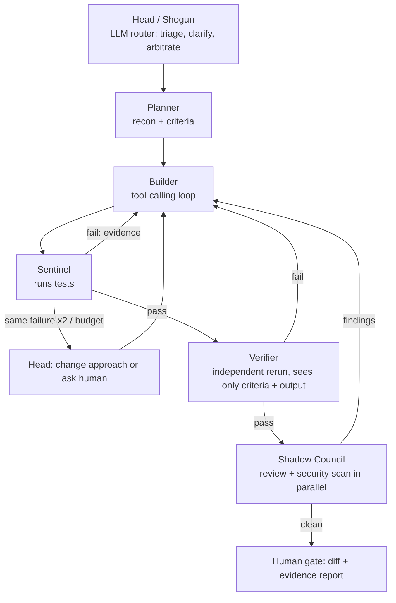

# DevPilot 開発道 (PS-001: The Mystic Mikado's Autonomous AI Engineering Guild)

Turns a natural-language request into a tested, reviewed change to a small repo. Nothing touches the real repo until a human approves.

## Setup
    pip install -r requirements.txt          # includes langgraph
    export NVIDIA_API_KEY=... OPENROUTER_API_KEY=... GOOGLE_API_KEY=...   # any subset; see .env.example
    python -m uvicorn devpilot.app:app --port 8000      # UI at http://localhost:8000
    python -m pytest -q tests
Config: `devpilot/config.yaml` (ordered provider fallbacks per role, plus all limits).

## Architecture

Head acts at the start (triage/clarify/task list) and on escalation only. Everything else is a direct handoff through conditional edges driven by evidence, so the Head does not relay messages.

## Agents
- **Head**: asks for clarification on ambiguous requests, writes the task list, on repeated failure orders a change of approach once, then stops and asks a human. Budgets are enforced in code.
- **Planner**: lists and reads the repo, outputs objective, acceptance criteria, files, conventions, risks.
- **Builder**: picks tools step by step (JSON action per step, max `max_steps`), reads `issues` and the last failure output.
- **Sentinel**: runs `pytest`; sends failing output straight back to the Builder.
- **Verifier**: reruns tests and judges criteria from raw output only.
- **Shadow Council**: LLM review and rule-based scan (secrets, SQL built from strings, shell execution, eval/exec, prompt-injection text, skipped tests) run in parallel. A **test-tamper guard** flags existing tests that lost assertions or were deleted, so the Builder cannot pass by weakening tests. High-severity findings go straight back to the Builder.

## Shared state and communication
- Typed `MissionState` (LangGraph): tasks, plan, attempt, per-failure counters, escalations, review rounds, open issues.
- SQLite append-only `events` table (`id, mission_id, ts, agent, type, refs, payload, evidence`). `refs` link events into a graph (finding -> fix -> test run). `GET /missions/{id}/graph` renders Mermaid.
- Provider fallbacks are logged as `router` decision events.

## Tools
`read_file`, `search_repo`, `edit_file`, `create_file` (new files and tests), `run_tests` (allowlisted `python -m pytest`), `git_diff`, `secret_scan`. Tool errors come back as text (`ERROR: ...`) so agents can adapt instead of crashing.

## Execution boundaries (`sandbox.py`)
Paths resolved with `..` and symlinks rejected outside the repo; command allowlist (pytest, ls, cat, git diff/status/log); timeouts; output cap. Work happens on a copy in `runs/<id>/work`.

## Bounded autonomy
`max_iters` builder runs, `max_steps` per run, `same_failure_limit`, `max_review_rounds`, `max_seconds` wall clock. Success = verifier confirms criteria from real test output.

## Human approval
Mission ends in `awaiting_approval`. `POST /missions/{id}/approve` copies the changed files into the real repo; `/reject` discards. Diff and the verified/assumed report are shown first.

## Demo run
`runs/sample-run.json` and `runs/sample-run-graph.mmd`: Shadow Council's scan finds the planted secret after tests already passed; the Builder's next action (event 32) references that critique (event 29), fixes it, tests and verifier rerun. **This saved run used the offline scripted model.** Re-record with real keys before submitting.

## Security assumptions
Single trusted operator; repo content is untrusted (scanned for injection text, but a model could still be misled); no network commands; secrets in `.env` only.

## Known limitations
- Provider calls are untested here: model IDs in `config.yaml` (incl. Nemotron 3 Ultra) are unverified, and the tool-calling smoke test per provider is not done. The builder uses JSON actions, not native function calling.
- The offline mock is scripted for `discount_shop` only. A real Sentinel-failure feedback loop has not been recorded yet.
- Human gate is a status check, not a LangGraph interrupt.
- Seeded repos: `discount_shop` (bug + planted secret), `failing_test` (test-driven recovery), `sqli_users` (planted SQL injection). The latter two start failing by design but have NOT been solved by any model yet. Feature and ambiguity scenarios, single-agent baseline and persistent memory are not built.
- 20 automated tests cover sandbox, graph flow, escalation, API approve/reject/SSE, scanner and tamper guard. The UI was never opened in a browser.
